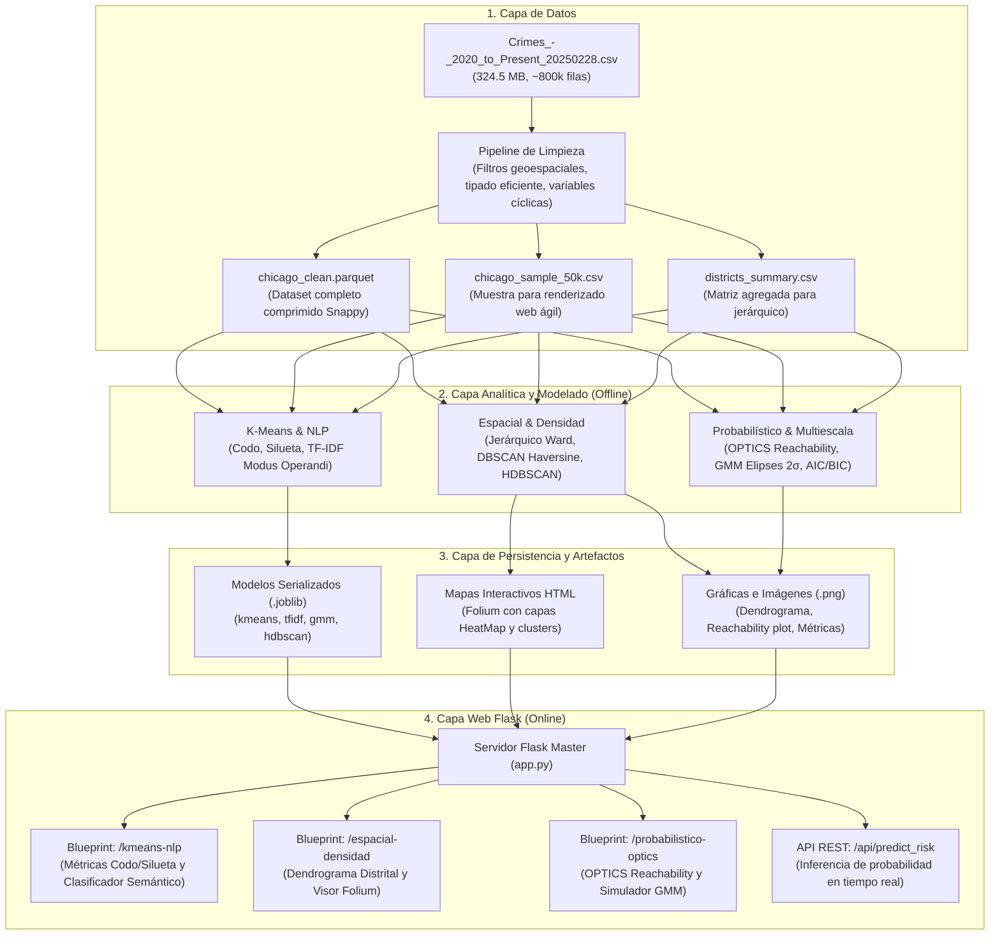

# Sistema de Inteligencia Urbana y Análisis No Supervisado de Criminalidad (Chicago 2020 - Presente)

[](https://www.python.org/)
[](https://scikit-learn.org/)
[](https://flask.palletsprojects.com/)
[](https://python-visualization.github.io/folium/)

Plataforma analítica e interactiva basada en **Machine Learning No Supervisado** para la detección de focos delictivos (*Hotspots*), segmentación multivariable de incidentes, modelado probabilístico de riesgo y minería de texto sobre el reporte de criminalidad de la ciudad de Chicago (2020 a 2025).

---

## 1. Objetivo del Proyecto

El proyecto tiene como propósito transformar un registro masivo de datos de seguridad ciudadana no etiquetados (~324.5 MB y más de 800,000 registros policiales) en una **herramienta interactiva de inteligencia urbana y apoyo a la toma de decisiones**. 

A través de modelos no supervisados, el sistema aborda los siguientes desafíos analíticos:
1. **Detección Cartográfica de Hotspots Delictivos:** Identificar automáticamente zonas críticas de alta densidad delictiva y separar incidentes aislados (ruido) sin requerir supervisión humana ni límites preestablecidos.
2. **Taxonomía Distrital de Zonas Urbanas:** Agrupar los distritos policiales de la ciudad según su perfil delictivo intrínseco (delitos violentos vs. contra la propiedad vs. fraudes).
3. **Modelado Probabilístico de Riesgo:** Estimar superficies continuas de riesgo y probabilidades suaves de ocurrencia delictiva mediante elipses de covarianza multivariantes.
4. **Minería de Modus Operandi (NLP):** Descubrir patrones ocultos en las descripciones textuales y tipos de ubicación mediante procesamiento de lenguaje natural (NLP) y vectorización semántica.
5. **Plataforma Web Interactiva:** Exponer todos los modelos, métricas y visualizaciones cartográficas en una aplicación web basada en Flask, permitiendo simulaciones y consultas interactivas.

---

## 2. Descripción del Dataset

- **Archivo Fuente:** `Crimes_-_2020_to_Present_20250228.csv` (Ubicado en `archive (1)/`).
- **Volumen:** 324.5 MB | ~800,000+ filas | 30 variables.
- **Diccionario de Variables Principales (`data.txt`):**
  - **Espaciales:** `Latitude`, `Longitude`, `X Coordinate`, `Y Coordinate`, `District`, `Ward`, `Community Area`, `Block`.
  - **Temporales:** `Date` (marca temporal completa), `Year`, `Updated On`.
  - **Tipológicas y Cualitativas:** `IUCR` (código de delito de Illinois), `Primary Type` (tipo principal: THEFT, BATTERY, ROBBERY, etc.), `Description` (subclasificación detallada), `Location Description` (entorno: calle, residencia, gasolinera, etc.).
  - **Operativas:** `Arrest` (arresto confirmado `True/False`), `Domestic` (incidente de violencia intrafamiliar `True/False`), `Beat` (sector de patrullaje).

---

## 3. Arquitectura del Sistema

El sistema implementa una arquitectura desacoplada en dos fases: **Pipeline Offline (Entrenamiento y Precomputación)** y **Pipeline Online (Servicio Web Interactivo)**.



### Justificación de la Separación Offline / Online:
Procesar 800,000 registros y calcular distancias espaciales o matrices TF-IDF en tiempo real dentro del ciclo de solicitud HTTP de un navegador provocaría tiempos de espera de varios minutos y agotamiento de memoria. Pre-entrenar y serializar los modelos con `joblib` y pre-generar los mapas interactivos permite que la aplicación web responda en menos de 50 milisegundos con alta interactividad.

---

## 4. Estructura de Directorios del Proyecto

```text
proyecto/
├── archive (1)/                         # Datos en bruto originales
│   ├── Crimes_-_2020_to_Present_20250228.csv
│   └── data.txt
├── data_processed/                      # Datos depurados y optimizados
│   ├── chicago_clean.parquet            # Dataset completo optimizado
│   ├── chicago_sample_50k.csv           # Muestra representativa para mapas
│   └── districts_summary.csv            # Agregaciones para clustering jerárquico
├── models_saved/                        # Modelos entrenados serializados
│   ├── kmeans_geo.joblib
│   ├── tfidf_vectorizer.joblib
│   ├── kmeans_text.joblib
│   ├── hdbscan_model.joblib
│   └── gmm_model.joblib
├── static/                              # Recursos estáticos servidos por Flask
│   ├── css/
│   │   └── style.css                    # Estilos CSS modernos (UI/UX)
│   ├── js/
│   │   └── dashboard.js                 # Lógica cliente y llamadas AJAX a API
│   ├── maps/                            # Mapas interactivos HTML de Folium
│   │   ├── mapa_dbscan_hotspots.html
│   │   └── mapa_hdbscan_estabilidad.html
│   └── img/                             # Gráficas de alta resolución
│       ├── dendrograma_distritos.png
│       ├── metricas_codo_silueta.png
│       └── optics_reachability.png
├── templates/                           # Plantillas HTML con motor Jinja2
│   ├── base.html                        # Layout maestro (Navbar, Sidebar, Footer)
│   ├── index.html                       # Dashboard principal con KPIs globales
│   ├── kmeans_nlp.html                  # Vistas K-Means y clasificador de texto
│   ├── espacial_densidad.html           # Vistas Jerárquico distrital y mapas Folium
│   └── probabilistico_optics.html       # Vistas OPTICS y simulador de riesgo GMM
├── modules/                             # Lógica analítica y de entrenamiento
│   ├── __init__.py
│   ├── data_cleaning.py                 # Pipeline de limpieza y conversión parquet
│   ├── train_kmeans_nlp.py              # Entrenamiento K-Means y NLP TF-IDF
│   ├── train_spatial_density.py         # Jerárquico distrital, DBSCAN y HDBSCAN
│   └── train_optics_gmm.py              # OPTICS, Modelos Mixtos Gaussianos y AIC/BIC
├── app.py                               # Servidor Flask Master
├── requirements.txt                     # Dependencias del proyecto
└── README.md                            # Documentación técnica del proyecto
```

---

## 5. Módulos Analíticos y Algoritmos Implementados

### 5.1 K-Means Multivariable y Métricas de Calidad
- **Variables de entrada:** Variables temporales cíclicas (`hour_sin`, `hour_cos`), día de la semana (`DayOfWeek`), indicador de fin de semana (`IsWeekend`), estatus de arresto y violencia doméstica.
- **Escalado:** `StandardScaler` para normalizar magnitudes numéricas.
- **Evaluación de $k$:** Evaluación para $k \in [2, 10]$ calculando de forma conjunta:
  - **Inercia (Método del Codo):** Detección del punto de desaceleración de la suma de errores cuadráticos.
  - **Silhouette Score:** Cohesión y separación media intra/inter cluster.
  - **Índice de Davies-Bouldin:** Nivel de solapamiento de clusters.

### 5.2 Minería Semántica de Texto y Modus Operandi (NLP + TF-IDF)
- **Preprocesamiento:** Concatenación enriquecida de `Description` + `Location Description` + `Primary Type`. Eliminación de caracteres especiales y filtrado de stopwords policiales en inglés.
- **Vectorización:** `TfidfVectorizer(max_features=1000, stop_words='english', ngram_range=(1, 2))`.
- **Clustering:** K-Means sobre la matriz dispersa para descubrir los 5 arquetipos principales de *modus operandi* (ej. robo a mano armada en vía pública, hurto en tienda minorista, altercado doméstico residencial, posesión de estupefacientes).
- **Proyección:** `TruncatedSVD` (LSA) para reducir la dimensionalidad de la matriz dispersa y generar visualizaciones 2D interpretables.

### 5.3 Clustering Jerárquico Aglomerativo Distrital
- **Solución al cuello de botella de memoria $O(N^2)$:** Se construye una matriz de contingencia normalizada que cruza los **22 Distritos Policiales** con las proporciones relativas de los tipos de delito.
- **Enlace:** Método de **Ward** con distancia euclidiana, minimizando la varianza total al fusionar zonas.
- **Salida:** Dendrograma taxonómico que evidencia la segmentación natural de la ciudad (macro-zonas con alta concentración de violencia armada vs. zonas comerciales de hurto vs. áreas residenciales de baja incidencia).

### 5.4 DBSCAN Geoespacial (Métrica Haversine)
- **Métrica:** Haversine sobre coordenadas transformadas a **radianes** (`np.radians`), permitiendo calcular distancias métricas reales sobre la curvatura de la Tierra.
- **Parámetros calibrados:**
  - $\varepsilon = \frac{d_{\text{km}}}{6371.0088}$ (ej. 300 metros $\rightarrow \varepsilon \approx 0.000047$ rad).
  - $MinPts = 25$ incidentes.
- **Capacidades:** Identifica clusters densos no esféricos (*Hotspots*) y aísla eventos esporádicos clasificándolos formalmente como **ruido (`-1`)**.

### 5.5 HDBSCAN y OPTICS para Densidades Variables
- **HDBSCAN:** Construye el Minimum Spanning Tree (MST) a partir de la distancia de alcanzabilidad mutua, condensa la jerarquía según `min_cluster_size` y extrae clusters estables persistentes ($\lambda = 1/\text{distancia}$). Resuelve la debilidad de DBSCAN al detectar simultáneamente focos ultra-densos en el centro (*The Loop*) y concentraciones difusas en la periferia.
- **OPTICS:** Genera el **Reachability Plot (Gráfico de Alcanzabilidad)**, donde los valles corresponden a núcleos densos de delincuencia y los picos representan transiciones urbanas.

### 5.6 Modelos Mixtos Gaussianos (GMM) y Elipses de Riesgo
- **Formulación:** Combinación lineal convexa de distribuciones normales multivariantes:
  $$p(x) = \sum_{k=1}^K \pi_k \mathcal{N}(x \mid \mu_k, \Sigma_k)$$
- **Ajuste:** Algoritmo Expectation-Maximization (EM) con matrices de covarianza `full` y regularización `reg_covar=1e-5` para prevenir singularidades numéricas.
- **Selección de Componentes:** Minimización rigurosa de criterios de información **AIC** y **BIC**.
- **Visualización:** Descomposición espectral de $\Sigma_k$ para proyectar **elipses de probabilidad de riesgo a $2\sigma$ (95.4% de confianza)**.

---

## 6. Guía de Ejecución Paso a Paso (Cómo Realizarlo)

### Paso 1: Configuración del Entorno Virtual
Crear y activar el entorno virtual de Python dentro de la carpeta `proyecto`:
```powershell
python -m venv venv
venv\Scripts\activate
```

Instalar las dependencias oficiales requeridas:
```powershell
pip install -r requirements.txt
```

*(Dependencias clave: `flask`, `pandas`, `numpy`, `scikit-learn`, `hdbscan`, `folium`, `matplotlib`, `seaborn`, `joblib`, `pyarrow`).*

---

### Paso 2: Limpieza y Optimización de Datos
Ejecutar el pipeline de preprocesamiento para depurar el CSV original y generar los datasets optimizados:
```powershell
python modules/data_cleaning.py
```
*Salidas generadas:*
- `data_processed/chicago_clean.parquet` (archivo de alta velocidad de lectura).
- `data_processed/chicago_sample_50k.csv` (muestra de 50,000 registros para visualización ágil en navegador).
- `data_processed/districts_summary.csv` (matriz distrital para el clustering jerárquico).

---

### Paso 3: Entrenamiento y Serialización de Modelos
Ejecutar secuencialmente los scripts de modelado para ajustar los algoritmos y guardar los artefactos:

1. **K-Means y NLP de Texto:**
   ```powershell
   python modules/train_kmeans_nlp.py
   ```
   *Genera:* `models_saved/kmeans_geo.joblib`, `models_saved/tfidf_vectorizer.joblib`, `models_saved/kmeans_text.joblib` y `static/img/metricas_codo_silueta.png`.

2. **Espacial, Jerárquico y Densidad:**
   ```powershell
   python modules/train_spatial_density.py
   ```
   *Genera:* `static/img/dendrograma_distritos.png`, `models_saved/hdbscan_model.joblib` y los mapas interactivos `static/maps/mapa_dbscan_hotspots.html` y `static/maps/mapa_hdbscan_estabilidad.html`.

3. **OPTICS y Modelos Mixtos Gaussianos:**
   ```powershell
   python modules/train_optics_gmm.py
   ```
   *Genera:* `static/img/optics_reachability.png` y `models_saved/gmm_model.joblib`.

---

### Paso 4: Despliegue de la Aplicación Web Flask
Iniciar el servidor web local:
```powershell
python app.py
```

Abrir cualquier navegador web en la dirección:
👉 **`http://localhost:5000`** (o `http://127.0.0.1:5000`).

---

## 7. Mapeo de Vistas y Rutas Web de la Plataforma

| Ruta Web | Funcionalidad y Elementos en Pantalla |
| :--- | :--- |
| **`/`** | **Dashboard Principal:** Tarjetas de resumen ejecutivo (KPIs: total de crímenes analizados, número de hotspots descubiertos, clusters semánticos detectados y tasa de ruido/outliers), gráfico de distribución y visión general. |
| **`/kmeans-nlp`** | **Módulo Particional y NLP:** Visualización interactiva de las curvas del Codo, Silueta y Davies-Bouldin. Incluye un **clasificador semántico en vivo** donde el analista escribe una descripción en texto y el sistema predice en milisegundos su categoría de *modus operandi*. |
| **`/espacial-densidad`** | **Módulo Geoespacial:** Visor en alta resolución del dendrograma de los 22 distritos policiales y un visor incrustado (`<iframe>`) del mapa dinámico de Folium con conmutador de capas (HeatMap de calor global vs marcadores coloreados de Hotspots de DBSCAN y puntos de ruido). |
| **`/probabilistico-optics`** | **Módulo Avanzado y Simulador de Riesgo:** Gráfica de alcanzabilidad (*Reachability Plot*) de OPTICS y **simulador interactivo de riesgo delictivo (GMM)**: el usuario ingresa coordenadas `(Lat, Lon)` y el modelo calcula la probabilidad de riesgo asociada y la elipse de cobertura normal. |
| **`/api/predict_risk`** | **Endpoint REST API:** Permite consultas programáticas `POST` enviando JSON con coordenadas para integraciones o consultas dinámicas asíncronas en JavaScript. |

---

## 8. Buenas Prácticas Técnicas y Rendimiento

1. **Gestión de Memoria en Mapas:** El mapa interactivo de Folium renderiza la muestra optimizada y utiliza `folium.plugins.FastMarkerCluster` y `folium.plugins.HeatMap`. Esto garantiza que el navegador mantenga una tasa fluida de 60 FPS sin saturar la memoria gráfica del cliente.
2. **Estabilidad Numérica en GMM:** Se utiliza `reg_covar=1e-5` para evitar que múltiples delitos con coordenadas idénticas colapsen la matriz de covarianza por varianza cero.
3. **Escalabilidad de Código:** La arquitectura basada en módulos y Blueprints de Flask permite incorporar nuevas fuentes de datos o algoritmos adicionales sin afectar las rutas ya existentes.
